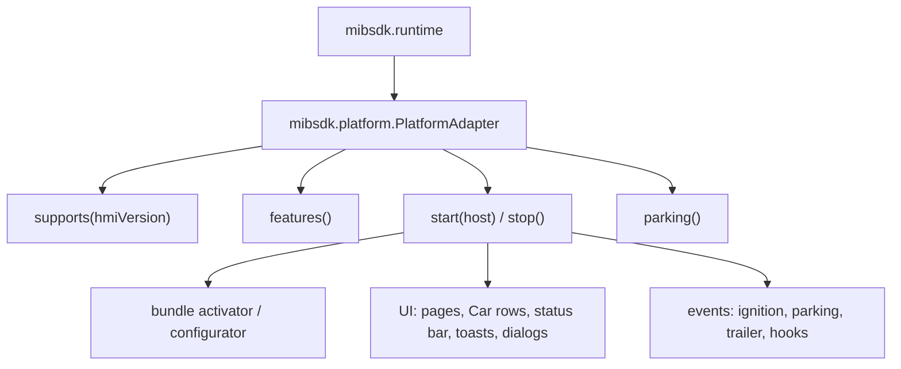

# Adding a firmware adapter

The plugin API is firmware-neutral. All car-specific code lives in one adapter behind
`mibsdk.platform.PlatformAdapter`. The repository ships one adapter, `adapter-hqc`, for
`HMI_AU_MIB2_HQC_NAR_G22_C10_180803`.

This page is the investigation and implementation guide for a second adapter. It is deliberately concrete:
you will pull files, build a map, and prove each layer on a bench unit before touching a car.

!!! warning
    A wrong adapter can boot-loop the HMI. Work on a bench unit, keep SSH or SD-card recovery available,
    and test safe mode before you install anything on a car.

## 1. What an adapter has to provide



| SPI member | What it must do |
|---|---|
| `id()` | A short adapter name, used in logs |
| `supports(hmiVersion)` | Exact match against the `HMI = ...` line, or a deliberate family rule |
| `features()` | The `mibsdk.api.Features` this build can provide |
| `start(PlatformHost)` | Register with the stock HMI, create the UI and event bridges, report features |
| `stop()` | Remove everything; restore stock state |
| `parking()` | A `ParkingIo` or null when the unit has no parking system |

The runtime never sees an stock HMI class. The adapter is the only module allowed to.

## 2. Inventory the unit

Start with the version and the boot chain.

```sh
ssh root@<unit-ip> 'grep "^HMI" /ifs/version_info.txt'
ssh root@<unit-ip> 'ls -la /mnt/app/eso/hmi/lsd /mnt/app/eso/hmi/lsd/jars /ifs'
```

Pull the stock files (see [Stock files](stock-files.md)):

```sh
./gradlew pullStockJars -Punit=<unit-ip> -PwithJars=1 -Pjxe2jarSrc=/path/to/jxe2jar/src
```

| File | What it tells you |
|---|---|
| `version_info.txt` | The exact `HMI = ...` string your `supports` must match |
| `lsd.sh` | Boot classpath, heap, system properties, bundle list selection, JXE path |
| `bundles*.properties` | Bundle activators and autostart order |
| `lsd/jars/*.jar` | Classes that shadow the JXE; note duplicates and load order |
| `lsd.jxe` / `lsd.jar` | The HMI itself: ~30k classes |
| `hmi.zip` | Developer-mode HMI classes, when present |
| `DSITracer.jar` | The DSI service tracer the adapter links against |

### Convert and inspect

The commands below use `de.<vendor>` and `de.<framework>` as placeholders for the package prefixes in your
image. Find the real prefixes with `unzip -l` first; do not copy the HQC build's names.

```sh
PYTHONPATH=/path/to/jxe2jar/src python3 /path/to/jxe2jar/src/jxe2jar.py \
    build/stock/lsd.jxe build/stock/lsd.jar

unzip -l build/stock/lsd.jar | grep -E 'de/<vendor>|de/<framework>|org/dsi' | head
javap -classpath build/stock/lsd.jar -p de.<vendor>.atip.base.Framework
```

For readable sources, decompile with CFR or Vineflower. Treat the output as a map, not as truth: `jxe2jar`
byte-swaps some numeric constants and can drop `InnerClasses` attributes. Verify anything you rely on
against the class file with `javap` or at runtime.

## 3. Build a firmware map

Write down evidence as you go. A table like this is worth more than a memory of a class name:

| Question | Where to look | Record |
|---|---|---|
| How does the HMI start? | `lsd.sh`, `startup.sh`, `runHMI.sh` | Command line, JXE path, boot classpath |
| Which bundles start? | `bundles.properties`, `bundles_*.properties` | Activator class, autostart order |
| What wraps DSI? | the `serviceDelegateConfigurator` property, `DSITracer.jar` | Configurator class and chain order |
| Where is the framework? | `IFrameworkAccess`, the framework access class | Service name, lookup method |
| Where is the screen model? | `DisplayManagerMIB2High`, `HMITerminalImplMIB2High` | Context ids, terminal ids |
| Where do screens come from? | `*ScreenFactory`, `ScreenBag`, `ConditionBank` | Factory class, model ids |
| Where is the status bar? | `StatusBar*`, `PartialPopup*` | Widget ids, model ids |
| How does input arrive? | `KbdListener`, `KeyEventDistributorEvo` | Key codes, focus path |
| How is parking exposed? | `org.dsi.ifc.*parking*`, `ParkingBridge` in HQC | Service name, methods |

The HQC adapter's classes are the reference for each row:

| HQC class | Pattern to copy |
|---|---|
| `HqcVersion` | Exact version match |
| `SdkBundleActivator` | Bundle entry point and lifecycle |
| `ConfiguratorCore`, `ChainingConfigurator` | Hooking the stock configurator chain |
| `HqcPlatform` | `PlatformAdapter` implementation and feature set |
| `SdkBoot`, `SdkGlobals`, `SdkFiles` | Runtime boot and on-unit paths |
| `ServiceWaiter`, `RawServices` | Waiting for late stock services |
| `DsiServiceProxy`, `DsiConstants`, `BridgeListener` | DSI proxies and event pumps |
| `IgnitionBridge`, `ParkingBridge`, `HookBindings` | Events, parking and hooks |
| `ui/HqcUiIds`, `ui/TextIds`, `ui/InputTextIds` | Stock id tables |
| `ui/SdkCarActivator`, `ui/SdkCarScreenFactory`, `ui/SdkCarModelBank` | Car drawer and screens |
| `ui/SdkSystemActivator`, `ui/SdkSystemScreenFactory` | Plugins menu and status bar |
| `ui/PageScreens`, `ui/PageRenderer`, `ui/PageWidgets` | Page rendering |
| `ui/BarStatusLine`, `ui/StatusSinks`, `ui/StatusPopupController` | Status-line and popup paths |
| `ui/ConfirmScreen`, `ui/SliderScreen`, `ui/SpellerScreen` | Dialogs and inputs |
| `ui/UiApplier`, `ui/UiInputs`, `ui/HmiPoster` | Applying snapshots and input |

### How to find a class you only know by behaviour

```sh
# Class names, without decompiling everything
unzip -l build/stock/lsd.jar | grep -i statusbar

# A string constant, a log line or a method name in the jar
zipgrep -a 'PDC R OFF' build/stock/lsd.jar || true

# One class's full signature
javap -classpath build/stock/lsd.jar -p -c de.<vendor>.atip.displaymanager.DSIDisplayManagerControllerImpl

# Decompile one package
cfr build/stock/lsd.jar --outputdir build/stock/src --jarfilter 'de.<vendor>.atip.base.*'
```

Prefer `javap` for facts and decompilers for shape. A decompiled name is a guess until the bytecode or the
bench confirms it.

## 4. Implement the adapter

1. **Copy the module shape.** Create `adapter-<name>` with the same dependencies as `adapter-hqc`:
   the stock `lsd.jar` and `DSITracer.jar`, `platform`, and the `mibsdk.car-library` convention.
2. **Version gate first.** Implement `supports` and make the SDK log `adapter=none` and stop on an
   unknown build. Never fall through to an HMI you have not tested.
3. **Boot.** Register a bundle activator and a configurator chain. Prove that the SDK starts, logs its
   `STATUS` lines and stops cleanly before you add UI.
4. **Services.** Wait for the framework access and the DSI services. Report features only when the
   service is actually available. Handle services that arrive late: call `PlatformHost.featuresChanged()`.
5. **UI, one path at a time:** Plugins menu, page, Car row, status item, toast, confirm. Keep the id
   tables in one class (`HqcUiIds` is the model) and never scatter raw stock ids.
6. **Events and parking.** Prove ignition and parking events, then the override and restore path.
7. **Hooks last.** Hooks depend on the DSI proxy and the stock thread model. Prove that no plugin code
   runs on a stock thread.

### What not to do

- Do not let plugin code touch the manufacturer's stock packages or `org.dsi.*`. The class-loader allow-list
  is the boundary.
- Do not shadow a stock class unless there is no other way. Every shadow is a firmware-specific liability.
- Do not run plugin code from a stock callback. Queue it on the plugin's worker.
- Do not assume a screen, model id or key code from another firmware. Measure it.
- Do not ship a stock jar, a decompiled class or an HMI image.

## 5. Bench loop

The adapter is the one part that cannot be tested on the host fake. Use a bench unit:

1. `./gradlew :dist:assembleUnit` and `./gradlew :dist:mibpkgPackage`.
2. Install the SDK with `installer/mibsdk-dev install <unit-ip>`.
3. Watch `installer/mibsdk-dev log <unit-ip>` for `STATUS` lines and startup errors.
4. Use `installer/mibsdk-dev ui-forcefail factory|screen|off` to prove the fallback paths.
5. Capture the screen after every UI change. A screenshot is evidence that the stock HMI drew what you
   think it did.
6. Test safe mode: `installer/mibsdk-dev safe-mode on`, reboot, then `off`.
7. Test a plugin that fails in `onEnable`, one that hangs, and one that is quarantined.

### Evidence to collect

| Area | Evidence |
|---|---|
| Version gate | Unknown build logs `adapter=none` and loads no plugin |
| Boot | Warm and cold boot, no boot loop, clean stop |
| Menu | SDK entry, Plugins page, Car drawer row |
| Pages | Every row kind and input on the real HMI |
| Status bar | Text, icon, colour, contexts, pagination, icon-only |
| Dialogs | Confirm, speller, toast, BACK and timeout |
| Parking | Read, override, restore on disable and ignition-off |
| Hooks | Veto and observe, no plugin code on a stock thread |
| Recovery | Safe mode, failed restore retry, uninstall restores stock files |

## 6. Definition of done

- `supports` matches exactly the documented build; anything else makes the SDK stay off.
- Every `PlatformAdapter` method is implemented and tested.
- Every reported `Feature` is real at that boot; a missing service is reported as missing.
- Plugin code never runs on a stock thread.
- The adapter compiles against the stock jars and passes `linkCheck`.
- `carJclSignatures` is regenerated and committed if the class library changed.
- A bench record exists for every UI path, with screenshots and a clean log.
- Safe mode and uninstall are tested.
- The docs say which build the adapter supports and what is still unproven.

## 7. Tips for a person or an agent

- Start with the version gate and the boot chain. Do not read 30,000 classes first.
- Build a map with exact class names, method names and evidence. Update it after every bench run.
- Use `javap` to confirm a signature; use a decompiler to understand the shape.
- Check whether a class is in `lsd.jxe` or in a shadow jar. The first copy on the boot classpath wins.
- When a name looks meaningful (`StatusBarStubController`), verify it with the model id it writes.
- Keep every experiment on a branch and in the bench record. A second adapter is a long investigation.
- The repository's internal research notes show the shape of one such map: the onboard Java map and the
  HMI UI injection notes. They describe the HQC build, not yours, but the questions and evidence style
  transfer.

## Related

- [Firmware support](../explanation/firmware-support.md)
- [Stock files](stock-files.md)
- [Architecture](../explanation/architecture.md)
- [Safety model](../explanation/safety-model.md)
