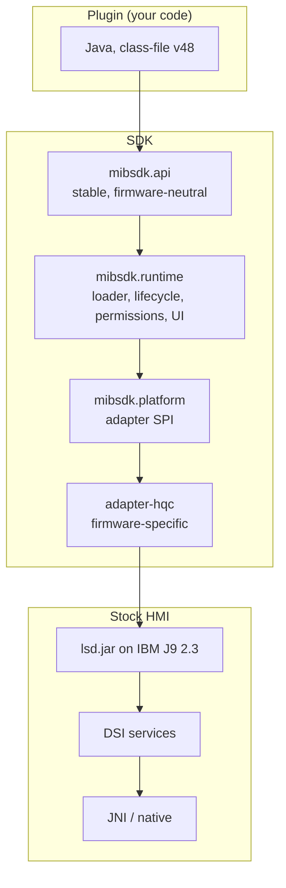
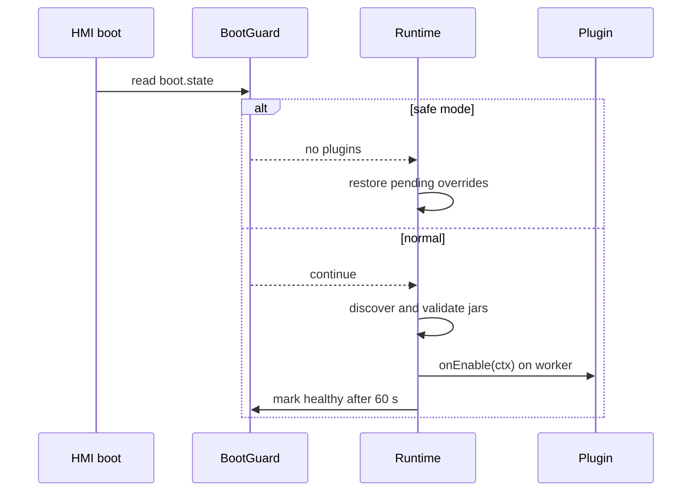
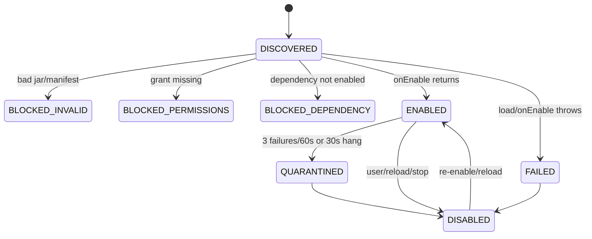

# Architecture

The SDK exists to make one firmware's HMI programmable without letting a plugin take the unit down. That
goal explains nearly every design choice: a narrow API, a filtered class loader, one worker per plugin,
declarative hooks and a firmware adapter.

## The layers

| Layer | Responsibility | Sees stock classes? |
|---|---|---|
| Plugin | Your feature | No |
| `mibsdk.api` | The contract | No |
| `mibsdk.runtime` | Discovery, enable/disable, permissions, storage, scheduler, UI table, boot guard | No |
| `mibsdk.platform` | The adapter contract and UI snapshot model | No |
| `adapter-hqc` | Bundle activator, configurator chain, DSI bridges, HMI drawing | Yes |
| Stock HMI | The manufacturer's classes, J9, DSI | — |

A plugin is compiled against `mibsdk.api` only. The class loader it runs in exposes `java.*`, `javax.*`,
`mibsdk.api.*`, `mibsdk.compat.*` and the Retrotranslator runtime; everything else is hidden. That is
why a plugin cannot call a stock HMI class even by accident.

## Boot

1. `lsd.sh` puts the SDK jars on the boot classpath.
2. The SDK bundle activator starts.
3. The configurator checks `/ifs/version_info.txt` and selects an adapter. No matching adapter means the
   SDK stops and loads no plugins.
4. The `BootGuard` reads `boot.state`. If the previous boots were unhealthy, this is a safe-mode boot:
   pending overrides are restored and no plugins load.
5. After the configured delay (30 s by default), the runtime discovers `plugins/*.jar`, validates each
   `plugin.json`, checks grants and enables the plugins in dependency order.
6. `healthyAfterMs` (60 s) after loading, the boot is marked healthy.

## Lifecycle

Disabling always cancels registrations, releases overrides, flushes storage and then runs `onDisable()`.
A plugin is constructed fresh for each run, so fields do not survive a reload; persistent state belongs
in storage.

## Threads

| Thread | Runs |
|---|---|
| HMI dispatcher and stock threads | Never plugin code |
| Runtime control thread | Load, enable, disable, reload, quarantine |
| One worker per plugin | `onEnable`, `onDisable`, actions, timers, events, dialog answers |
| Ledger thread | Applying and restoring overrides |
| Dev-channel thread | Reload markers and log mirroring |

One worker per plugin gives plugins a simple concurrency model: callbacks never overlap, so shared
fields need no locks. It also means a slow callback delays that plugin only. The worker is a daemon at
`NORM_PRIORITY - 1`.

## UI

Plugins describe UI; the runtime and adapter draw it.

1. A plugin builds a `PageSpec` and calls `ui.page`.
2. The runtime stores the page in a `UiTable` snapshot.
3. The adapter reads the snapshot and builds stock HMI widgets or list cells.
4. Input comes back as a `UiInput`, is mapped to a `UiAction`, and is queued on the plugin's worker.
5. Missing features produce inert handles rather than exceptions.

The same `UiTable` is used by the fake car, which is why host tests exercise the real UI model without
the HMI.

## Permissions

Permissions are declared in the manifest, approved by the user and enforced at the API boundary. The
build scans code for known permissioned calls; the runtime refuses a call whose permission is not
granted. A plugin missing any declared permission does not start.

This is a seat belt, not a sandbox. `platform.unrestricted` is the explicit escape hatch, and the SDK
cannot contain a plugin that uses it.

## Overrides

Vehicle writes go through an `OverrideLedger`:

- only one plugin may hold an override;
- the ledger records the prior value in `ledger.properties`;
- it restores on disable, uninstall, `UNTIL_IGNITION_OFF` and safe-mode boot;
- a failed restore is retried with backoff.

That is why a plugin can mute parking tones without leaving the car muted after a crash.

## The Java/native boundary

Everything above `adapter-hqc` is Java. `adapter-hqc` is also Java, but compiled against the stock jars
and allowed to use stock HMI classes. Below it, the stock HMI talks to DSI services and native code
(`ealswig`, Kanzi, the parking ECU) through JNI.

A plugin cannot cross that boundary directly. It reaches native daemons over TCP with `ctx.net()`
(loopback by default, outbound with `network.outbound`), and stock behaviour through declarative hooks. This keeps plugins portable across firmware
adapters and keeps a plugin from depending on a native ABI that may change.

## Why the build is unusual

The car loads only v48 class files and has a Java 1.4 library. The build therefore:

1. compiles with JDK 17 and `--release 8`;
2. lowers syntax with Retrolambda and Retrotranslator;
3. checks every class is v48;
4. checks every reference against a signature list of the car's class library;
5. checks permissions, API level and forbidden constructs;
6. stamps the jar so mibpkg can verify it.

A plugin developer sees ordinary Gradle tasks. The unusual parts are hidden behind `mibsdk.plugin`.

## Related

- [Project layout](../getting-started/project-layout.md)
- [Safety model](safety-model.md)
- [Firmware support](firmware-support.md)
