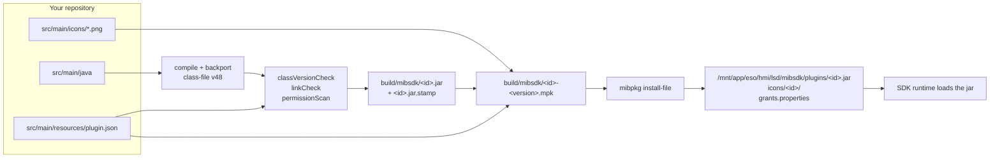
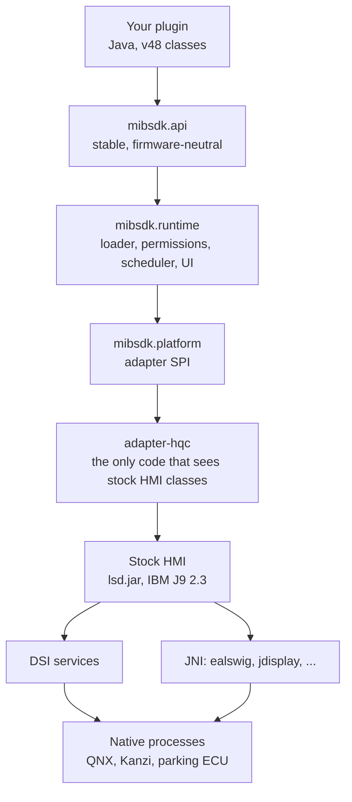

# Project layout

A plugin has two very different halves: **Java code** that is compiled and backported, and **assets**
that are copied into a package. This page shows where each lives, what ends up on the unit, and where
the SDK's own Java/native boundary sits.

## A plugin project

```text
my-plugin/
├── build.gradle.kts              one plugins block: id("mibsdk.plugin")
├── settings.gradle.kts           the SDK Maven repository
├── gradle.properties             mibsdk.repo and local overrides
├── gradlew, gradlew.bat          the Gradle wrapper
├── gradle/wrapper/               wrapper jar and properties
├── src/
│   ├── main/
│   │   ├── java/
│   │   │   └── example/myplugin/
│   │   │       └── MyPlugin.java       your code, compiled to v48
│   │   ├── resources/
│   │   │   └── plugin.json             the manifest, copied to the jar root
│   │   └── icons/
│   │       ├── icon.png                72 px Car-row icon (optional)
│   │       └── icon-20.png             20 px status icon (optional)
│   └── test/
│       └── java/example/myplugin/
│           └── MyPluginTest.java       host tests on the real runtime
└── build/                        generated; never edit or commit
```

| Path | Kind | What it is |
|---|---|---|
| `src/main/java` | Java | Your plugin classes. The build compiles with JDK 17 then lowers them to class-file v48 |
| `src/main/resources/plugin.json` | JSON | The manifest. It is copied to the jar root and read by mibpkg and the runtime |
| `src/main/icons/<name>.png` | PNG | Icons declared in the manifest. Never copied into the jar |
| `src/test/java` | Java | Host tests. Not shipped |
| `build.gradle.kts`, `settings.gradle.kts` | Kotlin DSL | Build configuration. Not shipped |
| `gradle/`, `gradlew*` | Gradle | The wrapper. Not shipped |

The layout is fixed by the `mibsdk.plugin` convention. `src/main/resources/plugin.json` and
`src/main/icons/<name>.png` are the two paths it requires; everything else is ordinary Gradle.

## What is built, and what ships



| Artifact | Contains | Use |
|---|---|---|
| `build/mibsdk/<id>.jar` | v48 classes and `plugin.json` | Hot-push during development |
| `build/mibsdk/<id>.jar.stamp` | The checks that ran and the jar's SHA-256 | Proof for mibpkg; keep it next to the jar |
| `build/mibsdk/<id>-<version>.mpk` | Jar, stamp, icons, generated `manifest.toml` | Normal installation and updates |
| `build/mibpkg-stage/` | The staged files before packing | Inspect when a package looks wrong |

The **jar** is what the class loader reads. The **package** is what mibpkg installs: it carries the jar,
the icons and the manifest data mibpkg shows in its approval sheet. A pushed jar carries no icons and no
new permissions.

## On the unit

| Path | Contents |
|---|---|
| `/mnt/app/eso/hmi/lsd/mibsdk/` | Install root, read-only while the HMI runs: `sdk.properties`, `grants.properties`, `SAFE_MODE`, `plugins/`, `stock/` |
| `/mnt/app/eso/hmi/lsd/mibsdk/plugins/<id>.jar` | Your installed plugin |
| `/mnt/persist/mibsdk/` | Persistent root: `boot.state`, `ledger.properties`, `data/` |
| `/mnt/persist/mibsdk/data/<id>/` | Your plugin's storage |
| `/ramdisk/mibsdk/cache/` | Volatile jar snapshots |
| `/tmp/mibsdk.log` | The SDK log mirror |

The install root is written only by mibpkg. The runtime never writes there.

## Java and native: two boundaries

### 1. Inside your plugin: Java plus assets

A plugin package contains only Java class files, `plugin.json` and PNG icons. There is **no native code
in a plugin**, no `.so`, no JNI and no NDK. If your plugin needs a native daemon, talk to it over
TCP with [`ctx.net()`](../guides/networking.md): loopback by default, outbound with `network.outbound`.

### 2. Inside the SDK: Java above, native below



| Layer | Language | Can a plugin see it? |
|---|---|---|
| Your plugin | Java, class-file v48 | Yes |
| `mibsdk.api` | Java, v48 | Yes |
| `mibsdk.runtime`, `mibsdk.platform` | Java, v48 | No; hidden by the plugin class loader |
| `adapter-hqc` | Java compiled against the stock jars | No |
| Stock HMI and DSI | Java and JNI | No |
| Native QNX services and Kanzi | Native | No; reachable only through the SDK's API or TCP networking |

The plugin class loader exposes only `java.*`, `javax.*`, `mibsdk.api.*`, `mibsdk.compat.*` and the
Retrotranslator runtime. The manufacturer's stock packages and `mibsdk.runtime.*` are hidden.
This is what makes a plugin firmware-neutral: the adapter is the only layer that knows the car.

A plugin cannot patch stock behaviour by shipping classes with the same names. Declarative hooks
(`ctx.hooks()`) are the supported route, and they are limited to parking for now.

## Where the SDK's own code lives

| Module | Role |
|---|---|
| `api/` | The plugin API and `permissions.json`; the only module a plugin compiles against |
| `compat/` | Java 1.4 shims for `java.util.function.*`, `Objects`, `AutoCloseable` and friends |
| `platform/` | Firmware-adapter SPI and the UI snapshot model |
| `runtime/` | Loader, permissions, storage, scheduler, UI, boot guard, quarantine, hooks |
| `adapter-hqc/` | The adapter for the supported HMI build; the only code that touches stock classes |
| `adapter-fake/` | Host-only fake car for tests |
| `plugin-test/` | `PluginTestHarness` for plugin host tests |

## Next

- [Tutorial](tutorial.md): build a real plugin.
- [Architecture](../explanation/architecture.md): how the layers work at runtime.
