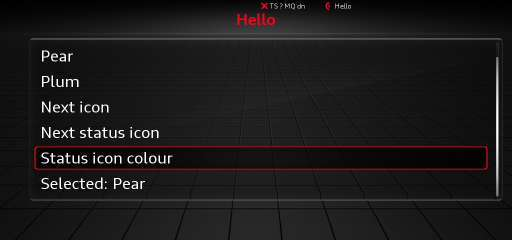

# Tutorial: build a coffee timer

In this tutorial you will build **coffee-timer**, a small plugin that:

- adds a **Coffee** row with a cup icon to the Car drawer;
- opens a page with a brew-time slider and a "pop up when ready" toggle;
- keeps both settings across reboots;
- counts down on the status line while it brews;
- shows a toast when the coffee is ready.



The finished plugin is in [`plugins/coffee-timer`](https://github.com/complex256/mib2q-plugin-sdk/tree/main/plugins/coffee-timer).
Every marked code block below is compared with that sample by the docs build, so the page and the
sample cannot drift apart.

**Before you start:** [install the SDK](install-sdk.md) on the unit and complete
[Prerequisites](prerequisites.md). You do not need a unit to write and test the plugin.

## 1. Create the project

```sh
git clone https://github.com/complex256/mib2q-plugin-sdk.git
cp -R mib2q-plugin-sdk/templates/plugin coffee-timer
cd coffee-timer
```

Rename the template's package and class to the tutorial's names:

- package `example.myplugin` → `tutorial.coffeetimer`
- class `MyPlugin` → `CoffeeTimerPlugin`

Delete the scaffolded `MyPlugin.java` and `MyPluginTest.java`; you will write the real ones below. Keep
the wrapper, the build file and the settings file.

The project should look like this:

```text
coffee-timer/
├── build.gradle.kts
├── settings.gradle.kts
├── gradle.properties
├── gradlew
├── src/
│   ├── main/
│   │   ├── java/tutorial/coffeetimer/CoffeeTimerPlugin.java
│   │   ├── resources/plugin.json
│   │   └── icons/
│   │       ├── cup.png
│   │       └── cup-20.png
│   └── test/java/tutorial/coffeetimer/CoffeeTimerPluginTest.java
└── .gitignore
```

## 2. The manifest

`plugin.json` tells the build and the unit what the plugin is and what it may do.

<!-- file: plugins/coffee-timer/src/main/resources/plugin.json -->
```json
{
  "id": "coffee-timer",
  "name": "Coffee Timer",
  "version": "1.0.0",
  "author": "your-name",
  "api": 5,
  "main": "tutorial.coffeetimer.CoffeeTimerPlugin",
  "permissions": ["ui.slot.carmenu", "ui.slot.statusbar"],
  "icons": ["cup", "cup-20"]
}
```

| Field | Here | Why |
|---|---|---|
| `id` | `coffee-timer` | Names the jar, the package and your storage |
| `api` | `5` | The plugin uses a slider and a toast, both api 5 |
| `main` | `tutorial.coffeetimer.CoffeeTimerPlugin` | The class the runtime instantiates |
| `permissions` | `ui.slot.carmenu`, `ui.slot.statusbar` | One for the Car row, one for the status item and toast |
| `icons` | `cup`, `cup-20` | One 72 px row icon and one status icon (20 px here; 30 px is the bar's native size) |

The build validates every name against the permission catalog and fails if your code uses a permission
the manifest does not declare.

## 3. Icons

The sample uses two PNGs:

| Icon | Size | Use |
|---|---|---|
| `cup.png` | 72×72 | Car-drawer row |
| `cup-20.png` | 20×20 | Status item and toast (the bar upscales it; 30×30 is crisp) |

Icons must be 8-bit RGBA (or grey + alpha), non-interlaced, at most 72 px either way and at most 32 KiB.
A white glyph on a transparent background looks like the stock icons. The sample's generator is
`plugins/coffee-timer/make_icons.py`:

```sh
python3 plugins/coffee-timer/make_icons.py src/main/icons
```

Any image editor that exports 8-bit RGBA works. The build checks the PNG rules and generates the faded
reflection the Car drawer draws under a row icon.

## 4. The plugin class

Create `src/main/java/tutorial/coffeetimer/CoffeeTimerPlugin.java`:

<!-- file: plugins/coffee-timer/src/main/java/tutorial/coffeetimer/CoffeeTimerPlugin.java -->
```java
package tutorial.coffeetimer;

import mibsdk.api.Icon;
import mibsdk.api.Log;
import mibsdk.api.MibPlugin;
import mibsdk.api.Page;
import mibsdk.api.PageSpec;
import mibsdk.api.PluginContext;
import mibsdk.api.Scheduler;
import mibsdk.api.StatusItem;
import mibsdk.api.Storage;
import mibsdk.api.Subscription;
import mibsdk.api.Ui;
import mibsdk.api.UiAction;

/**
 * A brew timer: a Car-drawer row opens the "Coffee timer" page, where you set the brew time (a slider) and whether a
 * toast pops up when it is done (a toggle). While a timer runs, the status line counts down; when it ends it says
 * "Coffee ready" until you dismiss it. The brew time and the toggle are kept in storage.
 */
public class CoffeeTimerPlugin extends MibPlugin {

    static final String PAGE_ID = "timer";
    static final int MIN_MINUTES = 1;
    static final int MAX_MINUTES = 10;
    static final int DEFAULT_MINUTES = 4;
    static final long MINUTE_MS = 60_000L;

    private Log log;
    private Storage storage;
    private Scheduler scheduler;
    private Ui ui;
    private Page page;
    private StatusItem status;
    private Icon cupSmall;

    private int minutes;           // the brew time, stored as "minutes"
    private boolean toastWhenReady; // stored as "toast" = on|off
    private int left;              // minutes left; 0 when no timer runs
    private boolean ready;         // the timer ended and nobody dismissed it yet
    private Subscription tick;     // the once-a-minute task while a timer runs

    @Override
    protected void onEnable(PluginContext ctx) {
        log = ctx.log();
        storage = ctx.storage();
        scheduler = ctx.scheduler();
        ui = ctx.ui();

        minutes = storedMinutes();
        toastWhenReady = !"off".equals(storage.get("toast", "on"));

        cupSmall = ui.icon("cup-20");
        page = ui.page(spec(), this::onAction);
        ui.carMenuRow("Coffee", page, ui.icon("cup"));
        status = ui.statusItem(null, cupSmall); // hidden until a timer runs
        log.info("enabled, brew time " + minutes + " min");
    }

    @Override
    protected void onDisable() {
        // The runtime has already cancelled the timer, the page, the row and the status item.
        log.info("disabled");
    }

    private void onAction(UiAction a) {
        switch (a.itemId()) {
            case "start" -> start();
            case "stop" -> stop();
            case "dismiss" -> {
                ready = false;
                status.set(null);
            }
            case "toast" -> {
                toastWhenReady = a.requestedOn().booleanValue();
                storage.put("toast", toastWhenReady ? "on" : "off");
            }
            case "minutes" -> {
                minutes = a.value().intValue();
                storage.put("minutes", String.valueOf(minutes));
            }
            default -> log.warn("unknown item " + a.itemId());
        }
        page.update(spec());
    }

    private void start() {
        cancelTick();
        ready = false;
        left = minutes;
        tick = scheduler.every(MINUTE_MS, this::onMinute);
        status.set("Coffee " + left + "m", cupSmall);
        log.info("brewing for " + minutes + " min");
    }

    private void stop() {
        cancelTick();
        left = 0;
        status.set(null);
        log.info("stopped");
    }

    private void onMinute() {
        left--;
        if (left > 0) {
            status.set("Coffee " + left + "m", cupSmall);
        } else {
            cancelTick();
            ready = true;
            status.set("Coffee ready", cupSmall);
            if (toastWhenReady) {
                ui.toast("Coffee is ready", cupSmall);
            }
            log.info("ready");
        }
        page.update(spec());
    }

    private void cancelTick() {
        if (tick != null) {
            tick.cancel();
            tick = null;
        }
    }

    private PageSpec spec() {
        PageSpec s = PageSpec.of(PAGE_ID, "Coffee timer");
        s = left > 0 ? s.item("stop", "Stop timer", left + " min left") : s.item("start", "Start timer", minutes + " min");
        if (ready) {
            s = s.item("dismiss", "Dismiss", null);
        }
        return s.toggle("toast", "Pop up when ready", toastWhenReady)
                .slider("minutes", "Brew time", MIN_MINUTES, MAX_MINUTES, 1, minutes, false)
                .info(ready ? "Your coffee is ready." : left > 0 ? "Brewing..." : "Set a brew time, then Start.");
    }

    /** The stored brew time, or the default when none is stored or it is out of range. */
    private int storedMinutes() {
        try {
            int m = Integer.parseInt(storage.get("minutes", String.valueOf(DEFAULT_MINUTES)));
            return m >= MIN_MINUTES && m <= MAX_MINUTES ? m : DEFAULT_MINUTES;
        } catch (NumberFormatException e) {
            return DEFAULT_MINUTES;
        }
    }
}
```

### What each part does

**Lifecycle.** The runtime creates the class with its no-argument constructor and calls `onEnable(ctx)`
once, on the plugin's own worker thread. `PluginContext` is the only door to the SDK. When the plugin is
disabled, reloaded, quarantined or the HMI shuts down, the runtime cancels everything the plugin
registered and then calls `onDisable()`. You do not have to clean up.

`onDisable()` also runs after an `onEnable()` that threw. Keep it defensive: fields assigned after the
failure point are still null.

**One worker per plugin.** `onEnable`, page actions, scheduler tasks, event listeners and dialog answers
all run on one SDK-owned thread, one at a time. That is why this class needs no `synchronized` and no
`volatile`. It also means a slow callback blocks the rest of your plugin: the SDK logs calls over 5 s and
quarantines a call that runs for 30 s. Your code never runs on an HMI thread.

**A page and a Car row.**

```java
page = ui.page(spec(), this::onAction);
ui.carMenuRow("Coffee", page, ui.icon("cup"));
```

`ui.page` registers the page; the SDK also lists it under the plugin's entry in the Plugins menu.
`carMenuRow` adds the Car-drawer row. A plugin may have at most 8 pages and 2 Car rows.

`PageSpec` is immutable. Every builder call returns a new spec; to change the screen, build a new spec
and call `page.update(spec)`. `spec()` rebuilds the page from the plugin's fields, which is the pattern
the samples use.

**A toggle and a slider.**

```java
return s.toggle("toast", "Pop up when ready", toastWhenReady)
        .slider("minutes", "Brew time", MIN_MINUTES, MAX_MINUTES, 1, minutes, false)
        .info(...);
```

A toggle is the HMI's native checkbox. It does **not** flip by itself: you receive `requestedOn()` and
must store the value and update the page. A slider sends each knob step as `value()`. It shows its
position, not its number, so the "Start timer" row shows the minutes in its value column.

A page may have at most 4 slider plus dropdown rows; they are drawn after the list rows. Slider rules:
`min < max`, `(max - min) % step == 0`, at most 24 steps, and the current value on the grid.

**A status item.**

```java
status = ui.statusItem(null, cupSmall);
status.set("Coffee " + left + "m", cupSmall);
```

A plugin has one status item. `set(null)` or `set("")` hides it. Text is capped at 12 characters; the
line is shared with other plugins and the SDK's own indicators, so put the important part first.
`set` never fails because the user hid the item.

**A toast.**

```java
ui.toast("Coffee is ready", cupSmall);
```

A toast shows 20 characters and an optional status icon (up to 30 px, drawn at 20 px) for 3 seconds. It
needs `ui.slot.statusbar` and is inert if the unit cannot show inputs.

**Storage.** `storage.get/put/remove` is a string map per plugin, persisted across reboots. It is capped
at 256 KiB per plugin and 1 MiB for all plugins; a `put` past the cap throws. Parse stored values
defensively, as `storedMinutes()` does, because the data may come from an older version of your plugin.

**Missing features are not errors.** If the unit cannot show the UI this boot, `page`, `carMenuRow`,
`statusItem` and `toast` still return handles, but they are inert. Count and argument checks still apply.
Use `ctx.has(Features.SLOT_CAR_MENU)` and friends when you need to know.

## 5. Run it on your computer

There is no emulator for the head unit. Instead, `PluginTestHarness` installs the built jar into a
temporary "unit", starts the real runtime on a fake car and gives you a fake screen.

Create `src/test/java/tutorial/coffeetimer/CoffeeTimerPluginTest.java`:

<!-- file: plugins/coffee-timer/src/test/java/tutorial/coffeetimer/CoffeeTimerPluginTest.java -->
```java
package tutorial.coffeetimer;

import static org.junit.jupiter.api.Assertions.assertEquals;
import static org.junit.jupiter.api.Assertions.assertNull;

import java.io.File;
import java.util.Arrays;
import java.util.List;
import java.util.Properties;
import mibsdk.adapter.fake.FakeUi;
import mibsdk.test.PluginTestHarness;
import org.junit.jupiter.api.AfterEach;
import org.junit.jupiter.api.Test;
import org.junit.jupiter.api.io.TempDir;

class CoffeeTimerPluginTest {

    @TempDir
    File tmp;

    private PluginTestHarness h;
    /** What the plugin stored on an earlier run: set before start. */
    private final Properties stored = new Properties();
    private FakeUi ui;
    /** A plugin page's key is "<plugin id>/<page id>". */
    private String page;
    private String row;
    private String cup20Sha;

    @AfterEach
    void tearDown() {
        if (h != null) {
            h.close();
        }
    }

    /** Installs the built jar into a temp "unit", starts the real runtime on the fake car and waits for the page. */
    private void start() {
        h = PluginTestHarness.builder(tmp).storedValues(stored).start();
        ui = h.ui();
        page = h.pageKey("timer");
        row = "[png:" + h.iconSha("cup") + "] Coffee";
        cup20Sha = h.iconSha("cup-20");
        h.await(() -> !ui.render(page).isEmpty(), "the page");
    }

    private void minutePasses() {
        h.advance(CoffeeTimerPlugin.MINUTE_MS);
    }

    // ---- the tests ----

    @Test
    void carRowOpensTheTimerPage() {
        start();
        h.await(() -> ui.carRows().contains(row), "the Coffee row: " + ui.carRows());
        ui.selectRow(ui.carRows().indexOf(row));
        h.await(() -> page.equals(ui.openPageKey()), "the page open");
        assertEquals(Arrays.asList(
                "Start timer: 4 min",
                "[on] Pop up when ready",
                "Brew time: 4 [1..10]",
                "Set a brew time, then Start."), ui.render(page));
    }

    @Test
    void sliderAndToggleAreStored() {
        start();
        ui.turn(page, "minutes", 7);
        h.await(() -> ui.render(page).contains("Start timer: 7 min"), "7 min");
        ui.toggle(page, "toast");
        h.await(() -> ui.render(page).contains("[off] Pop up when ready"), "toggle off");
        Properties stored = h.storedValues();
        assertEquals("7", stored.getProperty("minutes"));
        assertEquals("off", stored.getProperty("toast"));
    }

    @Test
    void storedValuesAreRestored() {
        stored.setProperty("minutes", "2");
        stored.setProperty("toast", "off");
        start();
        List<String> lines = ui.render(page);
        assertEquals("Start timer: 2 min", lines.get(0));
        assertEquals("[off] Pop up when ready", lines.get(1));
    }

    @Test
    void timerCountsDownOnTheStatusLineAndToasts() {
        start();
        ui.turn(page, "minutes", 2);
        h.await(() -> ui.render(page).contains("Start timer: 2 min"), "2 min");
        assertEquals("", ui.statusLine());
        ui.select(page, "start");
        h.await(() -> "Coffee 2m".equals(ui.statusLine()), "Coffee 2m on the status line");
        minutePasses();
        h.await(() -> "Coffee 1m".equals(ui.statusLine()), "Coffee 1m");
        assertNull(ui.toast());
        minutePasses();
        h.await(() -> "Coffee ready".equals(ui.statusLine()), "Coffee ready");
        h.await(() -> ("[png:" + cup20Sha + "] Coffee is ready").equals(ui.toast()), "the toast: " + ui.toast());
        h.await(() -> ui.render(page).contains("Dismiss"), "the Dismiss row");
        ui.select(page, "dismiss");
        h.await(() -> "".equals(ui.statusLine()), "the status item hidden");
    }

    @Test
    void noToastWhenTurnedOff() {
        start();
        ui.toggle(page, "toast");
        ui.turn(page, "minutes", 1);
        h.await(() -> ui.render(page).contains("Start timer: 1 min"), "1 min");
        ui.select(page, "start");
        h.await(() -> "Coffee 1m".equals(ui.statusLine()), "Coffee 1m");
        minutePasses();
        h.await(() -> "Coffee ready".equals(ui.statusLine()), "Coffee ready");
        assertNull(ui.toast());
    }

    @Test
    void stopCancelsTheTimer() {
        start();
        ui.select(page, "start");
        h.await(() -> "Coffee 4m".equals(ui.statusLine()), "Coffee 4m");
        h.await(() -> ui.render(page).contains("Stop timer: 4 min left"), "the Stop row");
        ui.select(page, "stop");
        h.await(() -> ui.render(page).contains("Start timer: 4 min"), "back to Start");
        assertEquals("", ui.statusLine());
    }
}
```

Run it:

```sh
./gradlew test
```

The build passes the jar and the icons to the test. `h.await(...)` waits up to five seconds for the
runtime, so assertions are not racing the plugin's worker thread. `h.advance(ms)` moves the plugin's
scheduler forward, so a two-minute timer runs in milliseconds.

See [Test your plugin](test-your-plugin.md) for the rest of the harness API.

## 6. Build the jar

```sh
./gradlew mibPluginJar
```

Output:

```text
build/mibsdk/coffee-timer.jar
build/mibsdk/coffee-timer.jar.stamp
build/reports/mibsdk/linkcheck.txt
build/reports/mibsdk/permissions.txt
```

Do not edit the jar after the build: mibpkg checks the stamp, which records the checks and the jar's
SHA-256.

## 7. Package and install

```sh
./gradlew mibpkgPackage -Pmibsdk.mibpkg=/path/to/mibpkg
```

Output: `build/mibsdk/coffee-timer-1.0.0.mpk`.

Install it with the mibpkg web interface, or over SSH:

```sh
installer/mibsdk-dev install-plugin build/mibsdk/coffee-timer-1.0.0.mpk <unit-ip>
# exits 3 and lists the permissions:
installer/mibsdk-dev install-plugin build/mibsdk/coffee-timer-1.0.0.mpk \
    --approve=ui.slot.carmenu,ui.slot.statusbar <unit-ip>
```

Open the Car drawer. The **Coffee** row is there.

### The fast loop

Once the package is installed (so the grants and icons exist on the unit), push code changes as a jar:

```sh
./gradlew mibPluginJar
installer/mibsdk-dev push build/mibsdk/coffee-timer.jar <unit-ip>
```

The runtime hot-reloads the jar within a couple of seconds, with no HMI restart. A push carries only the
jar: new icons or new permissions need a new package.

## 8. Where next

- [Pages and inputs](../guides/pages-and-inputs.md): every input, dialog and pattern.
- [Status line](../guides/status-line.md): icons, colours and per-screen visibility.
- [Icons](../guides/icons.md): sizes, reflections and built-in glyphs.
- [Test your plugin](test-your-plugin.md): grants, features, restart and storage.
- [Troubleshooting](../reference/troubleshooting.md): when it does not start.
