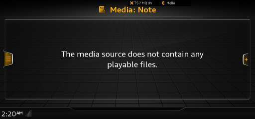

# Status line and toasts

A plugin can add **one short item** to the car's status line and show **toasts** at the top of the
screen. Both need the `ui.slot.statusbar` permission.



## A status item

```java
StatusItem status = ctx.ui().statusItem("Coffee 4m", ctx.ui().icon("cup-20"));
...
status.set("Coffee 3m");
status.set(null); // hide
```

| Rule | Value |
|---|---|
| Items per plugin | 1 |
| Text | 12 characters, truncated |
| Icon | 30×30 px, optional (a 20 px icon is upscaled) |
| Permission | `ui.slot.statusbar` |

`set(null)` or `set("")` hides the item. The item is not an error if the user hides it: the user can
reorder or hide items from the SDK's page in the Plugins menu, and `set` keeps working.

### Icons

```java
Icon cup = ctx.ui().icon("cup-20");            // tinted in the app colour
Icon logo = ctx.ui().icon("logo-20", Icon.OWN_COLOURS);
Icon star = ctx.ui().stockIcon(StockIcons.STAR);
```

- A plug-in icon is declared in `plugin.json` and lives at `src/main/icons/<name>.png`.
- Status icons are at most 30×30 px; a larger one throws `IllegalArgumentException`. A 20×20 icon still
  works: the built-in bar upscales it to the native 30 px, while a 30 px icon stays crisp.
- The icon must come from this plugin's `Ui`.
- Built-in icons need no file.

### Icon-only items

```java
status.setIcon(ctx.ui().icon("cup-20"));
status.setIcon(null); // hide
```

An icon-only item joins a shared icon row. The bar right-aligns the row and shows the highest-priority
icons first, left to right; when more icons exist than fit, the lower-priority ones continue on further
icon rows. A text item, with or without an icon, gets its own full-width row instead. The bar pages
through all of those rows with the dwell and animation settings below. Where the built-in bar has its
own right-side icons, those are the first page; the SDK's rows follow it. Calling `set(text)` goes back
to a text item.

### Colour

```java
status.setColour(UiColor.rgb(255, 180, 0));
status.setColour(null); // the bar's own colour
```

A colour is global: it applies in every HMI context and does not follow the palette. Only the text takes
it; icons keep their own colour rules. In the popup fallback (where the built-in bar is unavailable) the
text keeps the popup's colour.

### Per-screen visibility

```java
status.visibleIn(HmiContext.CAR);
status.visibleIn(HmiContext.CAR, HmiContext.MEDIA);
status.visibleIn(); // every context, the default
```

Contexts are the stock status bar's contexts: `CAR`, `TUNER`, `MEDIA`, `PHONE`, `NAVI`, `MAP`, `ONLINE`,
`OFFICE`, `TONE`, `SETTINGS`. `HmiContext.NONE` is not a context and is rejected.

The built-in bar applies the limit. The popup fallback shows every item.

## How the fallback line is shared

In the built-in bar each text item gets its own row, so the sharing rules here apply to the popup
fallback (where the built-in bar is unavailable). There the line is shared with the SDK's own indicators
and other plugins:

- Safety indicators (`SAFE`, `PDC R OFF`) always show.
- Plugin items share the remaining width fairly, in the user's order, then plugin id.
- An item shorter than its share shows whole; a longer one may be cut with `...`.
- When even three characters each do not fit, the last items are left out.

Put the important part first. "Coffee ready" is exactly 12 characters.

## Toasts

```java
ctx.ui().toast("Coffee is ready", cupSmall);
```

| Rule | Value |
|---|---|
| Text | 20 characters, truncated |
| Icon | 30×30 px, optional (drawn at 20 px in the toast) |
| Duration | 3 seconds |
| Permission | `ui.slot.statusbar` |
| Feature | `Features.UI_INPUTS`; inert without it |

A toast does not queue: a new toast replaces the previous one. It shows at the top of the screen and
disappears on its own.

## The SDK's status-bar settings

The SDK's entry in the Plugins menu holds the built-in bar's settings: on/off, dwell time (default 5 s),
animation (default 300 ms) and the global item order. They are stored in
`/mnt/persist/mibsdk/statusbar.properties`. A plugin cannot read or change them.

## Missing features

Without `Features.SLOT_STATUS_BAR` the item and the toast are inert. Without `Features.UI_ICONS` they
show without icons, but the icon size and ownership checks still apply.

## Related

- [Icons](icons.md)
- [Limits](../reference/limits.md)
- [Pages and inputs](pages-and-inputs.md)
