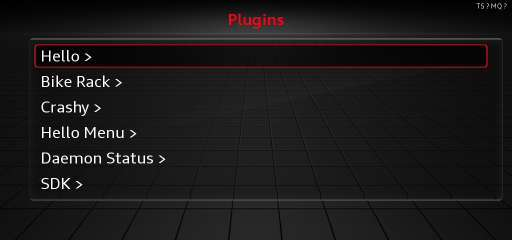

# mib2q plugin SDK

**Write plugins for the MIB2 High head unit in modern Java or Kotlin.**

The MIB2 High runs a 2008-era IBM J9 Java VM inside a QNX head unit. This SDK gives it a small plugin
platform in the spirit of Bukkit or Fabric: you write ordinary Java against a stable API, and the SDK
handles class-file backporting, loading, permissions, isolation, UI and recovery.

## Start here

-   **[Getting started](getting-started/index.md)**

    Install the SDK, create a project from the template, and build your first jar.

-   **[Tutorial](getting-started/tutorial.md)**

    Build the coffee-timer plugin step by step: a Car row, a page, a slider and a status item.

-   **[Project layout](getting-started/project-layout.md)**

    Learn what lives in a plugin project, what ships to the unit, and where the Java/native boundary is.

-   **[Java API reference](https://complex256.github.io/mib2q-plugin-sdk/api/)**

    Generated documentation for `mibsdk.api`, the test harness and the fake car.

## What a plugin can do

- Add a page built from native list cells, checkboxes, sliders, dropdowns and progress rows.
- Add a row to the Car drawer and a short item to the status line.
- Show toasts and dialogs using the HMI's own widgets.
- Run background work with a scheduler, persistent storage and TCP networking: loopback by default, outbound with an extra permission.
- Read vehicle state and parking-sound changes, and hold an override the SDK restores afterwards.

## Supported hardware

| | |
|---|---|
| Unit | **MHI2Q** (MIB2 High, QNX), the unit mibpkg calls `MHI2Q` |
| HMI build | **`HMI_AU_MIB2_HQC_NAR_G22_C10_180803`** |
| Package manager | mibpkg **0.9.1** or later |
| Plugin API | 1 through 7 (SDK 0.6.3) |

The firmware check is strict: on any other HMI build the SDK stays off and loads no plugins.

!!! warning "Experimental software for a car"
    This SDK has been verified on a bench MHI2Q, not yet on a car. It changes how the stock HMI boots,
    and a broken install can leave the HMI misbehaving until you recover it. Read the
    [safety model](explanation/safety-model.md) before installing. Installing this software is likely
    to void your warranty, and nothing here is affiliated with or endorsed by the vehicle or head-unit manufacturers.

## Documentation map

| Section | What it answers |
|---|---|
| [Getting started](getting-started/index.md) | How do I install the SDK and build my first plugin? |
| [Guides](guides/pages-and-inputs.md) | How do I build a page, an icon, a status item, a network poll? |
| [Reference](reference/plugin-manifest.md) | What are the exact fields, limits, permissions and build tasks? |
| [Explanation](explanation/architecture.md) | How does the SDK work, and why is it built this way? |
| [Contributing](contributing/index.md) | How do I build, test, release or improve the SDK itself? |
| [Java API](https://complex256.github.io/mib2q-plugin-sdk/api/) | What is the exact signature and contract of each API type? |
